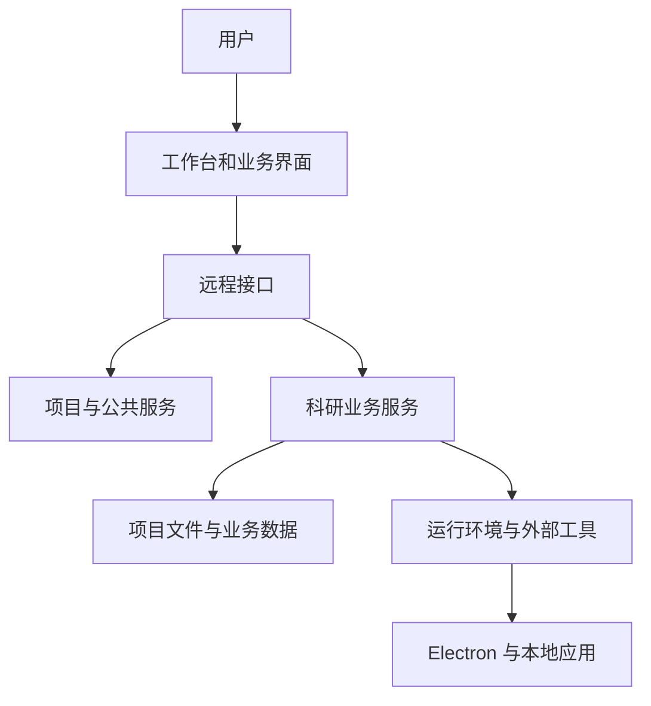

# iBM Lab 当前工作区代码说明

更新时间：2026-11-03

本文按当前工作区中的代码说明功能、目录和调用关系，主要面向后续开发与插件拆分。它描述的是当前实现，不代表拆分计划已经完成。

## 一、先看整体

iBM Lab 是一个桌面科研工作台。界面层负责展示工作台、项目与各业务页面；后端通过 DeepSeek Harness（下称 DSH）的服务和远程接口处理项目、文献、知识库、试剂、核磁和绘图；Electron 负责桌面窗口及与本地文件、外部软件的连接。

这里的“远程接口”主要是应用界面与本地宿主之间的调用接口，不意味着所有数据都会上传到外网。具体外部访问取决于用户操作与配置的数据源、模型服务等。

当前主要开发目录为 `Code/iBM-Lab-Agent-electron-next`，以下涉及源码的相对路径，除特别说明外，均以该目录为起点。

## 二、工作区顶层目录

| 路径 | 作用 |
| --- | --- |
| `Code/iBM-Lab-Agent-electron-next/` | 当前主要源码目录，包括界面、服务、Electron 桌面集成、构建脚本和测试。 |
| `Code/iBM-Lab-Agent/` | 另一个保留的源码目录；不能假定它与当前目录完全同步。修改本轮项目时以当前主要源码目录为准。 |
| `Code/Documents/` | 工作区内的项目文档资料。 |
| `Code/Releases/` | 工作区内已有的版本发布资料。 |
| `Code/Toolchain/` | 工作区内保存的工具链及运行环境相关内容。 |
| `outputs/` | 各类构建、验证或运行输出；具体用途以其中子目录为准。 |
| `work/`、`edge_pdf_capture/` | 工作过程中使用的其他目录和资料，不属于下文所述的主要源码入口。 |

## 三、主要源码目录

| 路径 | 作用 |
| --- | --- |
| `client/` | 用户界面源码和编译后的客户端入口。`client/src/` 是主要修改位置，`client/index.js` 是构建产物。 |
| `lib/` | DSH 服务、业务流程、工具注册和远程接口，是目前主要的后端实现。 |
| `src/` | 业务模型、数据结构、纯函数、运行时辅助代码等，供 `lib/` 和其他代码复用。 |
| `electron-next/` | 当前 Electron 桌面应用相关入口、启动配置与本地能力桥接。 |
| `desktop/` | 保留的 Tauri 桌面实现和相关脚本，当前 README 将其描述为保留的历史方案。 |
| `bundles/` | 当前按 core、runtime、documents、literature、design、analysis 组织的服务装配清单。 |
| `packages/` | 旧一轮领域拆包的包目录；目前这些包仍依赖旧主包，不能视为已完全独立的业务插件。 |
| `plugins/` | 新拆分工作开始使用的目录；目前有 `reagents/`，只迁入试剂目录解析与搜索逻辑，尚未完成独立装配。 |
| `presets/` | 科研助手预设和对应装配配置。 |
| `skills/` | 项目自带的技能说明，例如 Origin 绘图及自动排版相关技能。 |
| `scripts/` | 构建、启动、迁移、验证和运行辅助脚本；其中部分 `migration/` 文件也是实际功能验证脚本。 |
| `runtime/`、`python/` | 随应用使用的运行时、启动及 Python 环境相关内容。 |
| `vendor/` | 项目依赖或集成的外部代码与资源，例如 Mnova 桥接和 RAG 相关代码。 |
| `tests/` | 单元、集成、浏览器、Python 和端到端等测试。 |
| `docs/` | 项目设计、功能说明、迁移计划和版本说明。 |
| `browser-extension/` | 浏览器扩展相关代码。 |
| `ustc-api/`、`ustc-tunnel/` | 工作区内保留的学校服务接口和隧道相关代码。 |
| `package.json`、`pnpm-lock.yaml`、`package-lock.json` | Node 项目声明、命令及依赖锁定信息。 |

## 四、界面层：`client/src/`

界面代码使用 React。用户看到的工作台由多个组件拼装而成，界面调用后端时使用统一的接口描述与调用方式。

| 文件或文件组 | 负责内容 |
| --- | --- |
| `entry.js`、`apply.js` | 客户端入口和界面注册，将项目页面、阅读器、工作台等接入宿主。 |
| `workbench.js`、`workbench.css.js` | 工作台主界面、左侧功能入口、项目区域和对话区域布局。 |
| `components-project.js`、`project-tab.js` | 项目页面和项目内各类业务入口。 |
| `project-file-home.js`、`project-view-state.js`、`project-live-updates.js` | 项目文件入口、界面状态和项目更新。 |
| `components-literature.js`、`reader-*.js`、`reading-*.js` | 文献条目、PDF 阅读、译文、阅读操作与对话交互。 |
| `components-knowledge.js`、`knowledge.css.js` | RAG 知识库工作区和界面样式。 |
| `components-reagents.js`、`reagents.css.js` | 试剂清单的数据源配置、搜索和结果展示。 |
| `components-nmr.js`、`components-characterization.js`、`nmr-*.js` | 核磁任务、文件输入、模拟设置及相关界面。 |
| `components-plotting.js`、`plot-*.js` | 绘图工作区、图像编辑、排版和预览。 |
| `components-templates.js`、`components-settings.js` | 模板和应用设置界面。 |
| `desktop-client.js`、`webvpn-*.js`、`sidebar-browser.js` | 前端对接桌面能力、WebVPN 和内嵌浏览器。 |
| `descriptors.js` | 声明客户端可调用的后端接口及参数，新增或调整接口时需与后端对应。 |

构建方式：`node scripts/build-client.mjs`。它从 `client/src/entry.js` 打包生成 `client/index.js`。一般应先修改 `client/src/`，再重新构建，而不是只改生成文件。

## 五、项目核心：项目、记忆、文件与对话

| 文件或目录 | 负责内容 |
| --- | --- |
| `lib/core/index.js` | 核心服务 `ibmCore` 的入口，初始化项目存储、项目文件、项目对话和更新通知等。 |
| `lib/core/projects.js` | 项目的创建、查询和管理等方法。 |
| `lib/core/project-files.js` | 项目文件和工作区文件的组织、读写以及项目数据相关处理。 |
| `lib/core/project-conversations.js` | 项目与科研助手会话的关联和同步。 |
| `lib/core/project-updates.js` | 项目内容变化的通知。 |
| `lib/core/artifacts.js`、`history-files.js` | 项目成果及历史文件相关操作。 |
| `lib/core/domain.js`、`lib/repositories/` | 数据域定义和存取接口；当前核心仍承担历史 `lab_tasks` 数据的兼容。 |
| `lib/memory-tool.js` | 向助手提供项目记忆相关工具。 |
| `lib/remote.js` | 统一的 `lab` 接口入口，当前仍聚合多个业务接口，是后续解耦的重要位置。 |
| `src/contracts/` | 公共数据约定、能力状态和任务模型等。 |

项目记忆与 RAG 知识库不是同一件事：前者管理项目背景、目标等项目上下文；后者负责文档索引、检索和基于材料的问答。

## 六、各科研功能

### 1. 文献检索、精读、翻译和 PPT

文献功能的界面和后端目前分布在多个目录：

- `lib/tasks/`：文献检索、条目组织、阅读报告、PPT、文件接收与历史任务等工作流程。`workflows.js` 将多个方法模块组合为服务。
- `src/literature/`：检索、引用、材料匹配与阅读顺序等业务规则。
- `lib/literature-sources.js`、`lib/literature-browser.js`：文献来源和获取相关能力。
- `lib/note-templates.js`、`lib/ppt-templates.js`、`lib/ppt-build-tool.js`：阅读笔记模板、PPT 模板和生成工具。
- `client/src/reader-*.js`：阅读器、原文与译文显示、页面同步和 PDF 处理。
- `lib/tasks-tool.js` 等 `*-tool.js`：将部分操作注册为助手可使用的工具。

一次典型流程是：工作台发起检索或导入 → 文献任务服务建立记录 → 获取或接收 PDF/SI → 阅读、精读或翻译 → 登记报告与 PPT 等成果 → 项目页面展示历史记录与文件。

### 2. RAG 知识库

- `lib/knowledge.js`：项目知识库、资料导入、索引、检索、会话绑定等主要逻辑。
- `lib/rag/`：RAG 核心接口和相关运行代码。
- `lib/knowledge-tool.js`、`knowledge-assistant.js`、`knowledge-permissions.js`：知识库工具、助手协作和相关控制。
- `lib/knowledge-reading.js`：将知识库文献转入精读的协作逻辑；目前仍与文献任务代码有直接联系。
- `client/src/components-knowledge.js`：知识库页面。
- `vendor/dsh-rag/` 和 `scripts/build-rag.mjs`：RAG 相关外部代码与构建。

知识库目前已有独立界面与服务代码，但尚未形成可独立安装的完整子插件；Obsidian 接入仍属于后续工作。

### 3. 试剂管理

- `plugins/reagents/src/catalog.js`：试剂目录配置、读取、搜索与缓存。
- `plugins/reagents/src/workbook.js`：解析 Excel 清单。
- `plugins/reagents/package.json`：已抽出代码的包声明及依赖。
- `lib/reagents.js`、`src/reagents/workbook.js`：保留旧路径的兼容导出。
- `lib/remote.js`：目前仍包含试剂接口与桌面文件选择、打开操作。
- `client/src/components-reagents.js`：试剂清单界面。

当前只完成了解析和搜索代码的初步迁移；界面、接口和服务注册仍在旧宿主中，不能把它当作已完成独立安装的插件。

### 4. 核磁解析

- `lib/nmr.js`：核磁数据记录等服务。
- `lib/nmr-intake.js`、`lib/nmr-simulation.js`：核磁数据与结构文件接收、模拟相关逻辑。
- `src/nmr/`：核磁模型、模拟、结构处理和归属辅助规则。
- `lib/characterization.js`、`lib/analysis.js`：当前核磁任务和分析流程的一部分，也与绘图服务共同装配。
- `lib/mnova-tool.js`、`electron-next/mnova-open.mjs`、`vendor/mnova-mcp/`：Mnova 联动相关工具和桥接。
- `client/src/components-nmr.js`、`nmr-*.js`：核磁工作区与操作界面。

### 5. 科研绘图

- `lib/plot-records.js`、`lib/plot-workspace.js`：绘图记录和工作区操作。
- `lib/plot-images.js`、`lib/plot-layouts.js`：图像处理和图形排版。
- `src/plot/`：绘图模型、编辑、排版和调整规则。
- `lib/origin-mcp.js`、`electron-next/origin-open.mjs`：Origin 联动。
- `scripts/runtime/plot_*.py`：绘图处理、会话、图像或排版相关 Python 脚本。
- `client/src/components-plotting.js`、`plot-*.js`：绘图、预览、图像编辑和排版界面。
- `skills/ibm-origin-plotting/`、`skills/ibm-plot-auto-layout/`：绘图和排版相关技能。

核磁与绘图目前仍共享部分 `analysis`、`characterization` 服务及装配配置，还不是两个完全独立的子插件。

### 6. 论文润色与项目申报

论文润色在工作台中显示为暂不可用的占位页面，尚未实现可安装的独立插件或专用执行工具。项目申报入口已从当前工作台移除，远程接口阻止写入新的申报草稿；历史草稿仍保留读取路径。

### 7. 其他已有功能

`lib/chemistry.js`、`lib/synthesis.js`、`src/chemistry/`、`src/synthesis/` 和对应界面包含化学信息、合成路线与实验设计等已有功能。它们不等于上述六个目标子插件，当前仍在代码中；拆分时应依据计划处理归属，不应把保留代码误认为已迁移。

## 七、桌面、运行环境和外部软件

| 文件或目录 | 负责内容 |
| --- | --- |
| `electron-next/ibm-bootstrap.mjs` | Electron 启动与运行环境初始化入口之一。 |
| `electron-next/scientific-main.mjs`、`scientific-runtime.mjs` | 桌面科研能力和运行时对接。 |
| `lib/scientific-desktop.js` | 后端服务与桌面能力之间的桥接。 |
| `lib/runtime.js`、`lib/python-env.js`、`lib/version-registry.js` | 外部执行环境、Python 环境和版本登记。 |
| `electron-next/literature-access.mjs`、`pdf-browser-policy.mjs` 等 | 文献访问和桌面内文档浏览相关逻辑。 |
| `runtime/`、`scripts/runtime/` | 可执行程序、外部应用调用及配套脚本。 |

Origin 与 Mnova 分别需要相应外部软件及可用的连接环境；代码存在不代表当前机器已经具备所有运行条件。

## 八、当前装配方式与插件拆分进度

当前 `bundles/catalog.json` 把服务分为 `core`、`runtime`、`documents`、`literature`、`design`、`analysis`。`bundles/*.patch.yml` 描述这些服务如何由 DSH 装配；`cordis.patch.yml` 是现有组合配置之一。

`packages/dsh-lab-*` 是此前的领域拆包结果，但这些包仍依赖内部旧主包并转出其实现。因此，目录中存在多个包，并不等于已经实现用户要求的“一个母插件加六个可选、相互解耦的子插件”。

目前实际状态：

| 目标 | 当前状态 |
| --- | --- |
| 母插件 | 核心项目服务已存在，但尚未完成按新方案的完整抽离、插件装配和工具动态更新。 |
| 文献阅读 | 功能已有，尚未完整迁移为目标独立插件。 |
| RAG 知识库 | 功能已有，尚未独立打包；与精读协作仍有直接代码联系。 |
| 试剂管理 | 解析和搜索已放入 `plugins/reagents/`，界面及宿主接口仍待迁移。 |
| 核磁解析 | 功能已有，仍与绘图共享部分分析服务和装配。 |
| 科研绘图 | 功能已有，仍与核磁共享部分分析服务和装配。 |
| 论文润色 | 工作台占位，尚无可独立安装的插件实现。 |

具体目标、迁移顺序和验收标准见 `docs/PLUGIN_DECOUPLING_PLAN_2026-11-03.md`。拆分未完成之前，应按现有代码的真实依赖开发和验证。

## 九、测试与常用命令

| 命令或位置 | 用途 |
| --- | --- |
| `node scripts/build-client.mjs` | 根据界面源码生成客户端入口。 |
| `node scripts/build-client.mjs --check` | 检查界面源码与生成文件是否一致。 |
| `node --test tests/unit/*.test.mjs` | 运行 JavaScript 单元测试。 |
| `node --test tests/integration/*.test.mjs` | 运行集成测试。 |
| `tests/browser/` | 浏览器界面测试，具体测试可能需要可用的浏览器。 |
| `tests/python/` | Python 相关测试。 |
| `plugins/reagents/test/` | 已抽出的试剂包自身测试。 |
| `scripts/regression/` | 项目现有回归验证脚本。 |

Windows PowerShell 中的通配符、Node 环境和各测试所需外部应用可能影响命令运行；优先查看 `package.json` 和对应测试文件的实际要求。此前界面回归有两项涉及精读界面的断言失败，不能把它们视为已通过。

## 十、修改功能时从哪里入手

| 想修改的内容 | 建议先看 |
| --- | --- |
| 工作台入口、栏目或页面布局 | `client/src/workbench.js`、`client/src/workbench.css.js` |
| 项目文件、项目记忆和会话绑定 | `lib/core/`、`lib/memory-tool.js`、`client/src/project-*.js` |
| 新增或修改界面调用 | `client/src/descriptors.js`、`lib/remote.js`，再跟踪对应业务服务 |
| 文献检索、精读或 PPT | `lib/tasks/`、`src/literature/` 和 `client/src/reader-*.js` |
| RAG 资料、检索和问答 | `lib/knowledge.js`、`lib/rag/`、`client/src/components-knowledge.js` |
| 试剂表解析与搜索 | `plugins/reagents/src/`，涉及界面或文件选择时再看 `components-reagents.js` 与 `lib/remote.js` |
| 核磁解析或 Mnova | `lib/nmr*.js`、`lib/characterization.js`、`src/nmr/`、`vendor/mnova-mcp/` |
| 绘图或 Origin | `lib/plot*.js`、`src/plot/`、`lib/origin-mcp.js`、`client/src/plot-*.js` |
| 服务装配或插件拆分 | `bundles/catalog.json`、`bundles/*.patch.yml`、`packages/`、拆分计划文档 |
| Windows 桌面启动或安装 | `electron-next/`、`scripts/` 中的构建脚本和 `docs/releases/` |

对外显示的应用名称应保持 **iBM Lab**；内部包名、应用 ID 和既有数据路径属于兼容性标识，不应仅因名称而机械替换。
